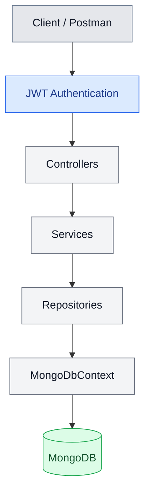

# BankingLedgerApi

### Secure Banking Ledger Management API built with ASP.NET Core and MongoDB

A backend REST API for managing customers, bank accounts, and financial transactions, with JWT-based authentication, password hashing, and customer-level ownership authorization.

Built using **C#, ASP.NET Core Web API, .NET 10, and MongoDB**, this project focuses on clean separation of concerns, secure API access, and maintaining a structured banking ledger.

---

## Overview

BankingLedgerApi is a backend application designed around common banking operations, including customer management, account management, deposits, withdrawals, and transaction history.

The application uses a layered architecture to separate HTTP handling, business logic, and database access. Authentication is implemented using JWT access tokens, while customer ownership checks prevent authenticated users from accessing other customers' records through the protected customer-by-ID endpoint.

### Key Features

- **Customer Management** — Create and retrieve customer records.
- **Bank Account Management** — Manage bank accounts and retrieve account information and balances.
- **Ledger Transactions** — Support deposits, withdrawals, and transaction history.
- **JWT Authentication** — Register users, authenticate credentials, and issue access tokens.
- **Password Hashing** — Hash passwords using ASP.NET Core Identity's `PasswordHasher<T>`.
- **Customer Ownership Authorization** — Verify ownership before returning a customer record by ID.
- **User–Customer Linking** — Associate registered users and customer records through MongoDB ObjectIds.
- **MongoDB Integration** — Persist application data in MongoDB collections.
- **Repository Pattern** — Separate database operations from business logic.
- **Input Validation** — Use data annotations on registration and login DTOs.
- **Unique Email Index** — Create a MongoDB unique index for user email addresses.
- **API Testing** — Validate authentication and authorization behavior using Postman.

---

## Tech Stack

| Technology | Purpose |
|---|---|
| C# | Backend programming language |
| .NET 10 | Application runtime and SDK target |
| ASP.NET Core Web API | REST API framework |
| MongoDB | NoSQL database |
| MongoDB.Driver | MongoDB data access |
| JWT Bearer Authentication | Token-based API authentication |
| ASP.NET Core Identity | Password hashing and verification |
| Data Annotations | Request validation |
| Swagger / OpenAPI | API exploration and documentation |
| Postman | API testing |
| Git and GitHub | Version control |

---

## Architecture

The application follows a layered architecture that separates responsibilities and makes the code easier to maintain and extend.



### Layer Responsibilities

**Controllers**
- Handle incoming HTTP requests and responses.
- Receive validated request data through DTOs.
- Call the appropriate service methods.
- Return suitable HTTP status codes.

**Services**
- Contain application and business logic.
- Coordinate authentication, customer management, and banking operations.
- Apply validation and business rules where implemented.

**Repositories**
- Encapsulate MongoDB data access.
- Retrieve, create, and update application documents.
- Keep database operations separate from service logic.

**Data**
- Provides the MongoDB context.
- Exposes the application's collections.
- Configures database indexes.

**Models**
- Define MongoDB document structures.
- Map C# properties to MongoDB fields using BSON attributes.
- Represent users, customers, bank accounts, and ledger transactions.

**DTOs**
- Define request data accepted by API endpoints.
- Apply validation rules to incoming registration and login data.
- Avoid using database document models directly as request contracts where DTOs are defined.

---

## Project Structure

```text
BankingLedgerApi/
│
├── Controllers/
│   ├── AuthController.cs
│   ├── CustomersController.cs
│   ├── AccountsController.cs
│   └── TransactionsController.cs
│
├── Data/
│   └── MongoDbContext.cs
│
├── DTOs/
│   ├── RegisterDto.cs
│   ├── LoginDto.cs
│   ├── CreateCustomerDto.cs
│   ├── CreateAccountDto.cs
│   └── MoneyTransactionDto.cs
│
├── Models/
│   ├── AppUser.cs
│   ├── Customer.cs
│   ├── BankAccount.cs
│   └── LedgerTransaction.cs
│
├── Repositories/
│   ├── IUserRepository.cs
│   ├── UserRepository.cs
│   ├── ICustomerRepository.cs
│   ├── CustomerRepository.cs
│   ├── IAccountRepository.cs
│   ├── AccountRepository.cs
│   ├── ITransactionRepository.cs
│   └── TransactionRepository.cs
│
├── Services/
│   ├── AuthService.cs
│   ├── CustomerService.cs
│   ├── AccountService.cs
│   └── TransactionService.cs
│
├── Properties/
├── Program.cs
├── appsettings.json
├── BankingLedgerApi.csproj
├── .gitignore
└── README.md
```

*The structure above reflects the intended organization of the existing project. Keep any additional files already present in your repository.*

---

## Authentication and Authorization

### JWT Authentication

The authentication workflow supports user registration and login.

1. A user submits registration details.
2. The API checks whether the email is already registered.
3. The password is hashed before the user is stored.
4. The user is associated with an existing customer record by email, if available and unlinked, or a new customer record is created.
5. During login, the submitted password is verified against the stored hash.
6. A successful login returns a signed JWT access token.

The token contains identity claims, including the user ID, name, email, and role.

### User–Customer Relationship

The application maintains a relationship between the registered user and their customer record.

```text
AppUser
  ├── Id
  └── CustomerId ───────────────┐
                                │
                                ▼
Customer                        _id
  ├── AppUserId ────────────────┘
  ├── FullName
  ├── Email
  └── PhoneNumber
```

The IDs are stored as MongoDB ObjectIds and represented as strings in the corresponding C# models.

### Customer Ownership Authorization

The customer-by-ID endpoint checks the authenticated user's ID against the customer's `AppUserId`.

- The owner can retrieve their customer record.
- A different authenticated user receives `404 Not Found`.
- A request without a valid bearer token receives `401 Unauthorized`.

**Authorization scope:** This ownership check is implemented for the customer-by-ID endpoint. Equivalent ownership checks for all account and transaction operations, role-specific authorization policies, and production-grade registration rollback are further hardening tasks.

---

## API Overview

The application exposes the following API areas. Use Swagger or the controller implementations to verify the exact HTTP methods, routes, and request schemas.

| API area | Purpose |
|---|---|
| Authentication | Registration, login, and current-user information |
| Customers | Customer creation and customer retrieval |
| Accounts | Account creation, account details, and balance retrieval |
| Transactions | Deposits, withdrawals, and ledger history |

### Authentication Endpoints

| Method | Endpoint | Purpose |
|---|---|---|
| POST | `/api/auth/register` | Register a user and associate a customer record |
| POST | `/api/auth/login` | Authenticate credentials and obtain a JWT |
| GET | `/api/auth/me` | Retrieve identity information from the authenticated token |

### Using a Protected Endpoint

For authenticated endpoints:

1. Register or log in to obtain a JWT.
2. Open the protected request in Postman.
3. Select **Authorization → Bearer Token**.
4. Paste the access token.
5. Send the request.

Include the token in the `Authorization` header:

```http
Authorization: Bearer YOUR_ACCESS_TOKEN
```

Do not commit real tokens or credentials to source control.

---

## Database Design

Database: `BankingLedgerDb`

MongoDB collections include:

| Collection | Responsibility |
|---|---|
| `users` | Login identity, password hash, role, and customer reference |
| `customers` | Customer profile and linked user reference |
| `accounts` | Account number, customer reference, balance, currency, and status |
| `transactions` | Financial transaction and ledger information |

### Important Relationships

- A user references their customer through `customerId`.
- A customer references their linked user through `appUserId`.
- A bank account references its customer through `customerId`.
- Transactions record banking activity according to the transaction model.

MongoDB BSON attributes are used to control stored field names and ObjectId representation.

### Indexing

A unique index named `unique_user_email` is created on the user email field to prevent duplicate user email values at the database level.

---

## Getting Started

### Prerequisites

Install the following:

- [.NET 10 SDK](https://dotnet.microsoft.com/download/dotnet/10.0)
- [MongoDB Community Server](https://www.mongodb.com/try/download/community)
- [MongoDB Compass](https://www.mongodb.com/try/download/compass) (optional)
- [Postman](https://www.postman.com/downloads/)
- Git

### 1. Clone the Repository

```bash
git clone YOUR_GITHUB_REPOSITORY_URL
cd BankingLedgerApi
```

Replace the repository URL with the actual GitHub repository URL.

### 2. Start MongoDB

For the current local development configuration, MongoDB runs at:

```text
mongodb://127.0.0.1:27017
```

The application database is:

```text
BankingLedgerDb
```

Ensure the MongoDB service is running before starting the API.

### 3. Configure Application Settings

Review `appsettings.json` and configure the MongoDB connection string and database name using the configuration keys read by `MongoDbContext`.

JWT configuration uses these keys:

```text
Jwt:Secret
Jwt:Issuer
Jwt:Audience
```

The issuer and audience should match the values expected by the token validation configuration.

**Never store a production JWT signing secret in a committed configuration file.**

For local development, initialize .NET User Secrets if necessary:

```bash
dotnet user-secrets init
```

Set a strong secret without committing it to Git:

```bash
dotnet user-secrets set "Jwt:Secret" "YOUR_STRONG_RANDOM_SECRET"
```

Set the issuer and audience if they are not already configured:

```bash
dotnet user-secrets set "Jwt:Issuer" "BankingLedgerApi"
dotnet user-secrets set "Jwt:Audience" "BankingLedgerApiClient"
```

Use a securely generated secret appropriate for the configured signing algorithm. Never share the actual secret in a README, GitHub issue, screenshot, or chat.

### 4. Restore Dependencies

```bash
dotnet restore
```

### 5. Build the Project

```bash
dotnet build
```

### 6. Run the API

```bash
dotnet run
```

Use the actual HTTP or HTTPS URL printed by the application in your API client.

### 7. Explore the API

If Swagger is enabled for the current environment, open the Swagger UI URL shown by your application or configured in `Program.cs`.

You can also import or recreate the requests in Postman.

---

## Security Considerations

This project incorporates several foundational security measures:

- Passwords are hashed using `PasswordHasher<AppUser>`.
- JWTs are validated by ASP.NET Core authentication middleware.
- Protected endpoints use authorization attributes.
- Customer ownership is checked before returning a customer record by ID.
- A unique user email index helps enforce uniqueness.
- Secrets should be provided through User Secrets or environment-specific configuration.

Before production use, further work is required around consistent ownership enforcement across all banking endpoints, atomicity or recovery for multi-document operations, rate limiting, audit logging, comprehensive validation, and automated security testing.

**Financial data integrity matters:** the current local MongoDB deployment is standalone, so multi-document transactions cannot be assumed to be available. Deposits, withdrawals, and transfers must be reviewed for concurrency, balance consistency, and failure recovery before production use.

---

## Engineering Principles

The project is organized around these principles:

- **Separation of Concerns** — Controllers, services, repositories, and database context have distinct responsibilities.
- **Dependency Injection** — Services and repositories are supplied through ASP.NET Core's dependency injection system.
- **Repository Pattern** — Database access is isolated behind repository contracts.
- **DTO-Based Requests** — API request models are separated from persistence models where implemented.
- **Explicit Authentication** — JWT bearer tokens establish the caller's identity.
- **Resource Ownership Checks** — Protected customer retrieval validates ownership.
- **Configuration Separation** — Environment-specific secrets should not be committed to the repository.

---

## Project Status

**Development stage:** Core API and authentication implementation.

Customer, account, and transaction API functionality has been developed, and JWT authentication and customer-level ownership checks have been tested. Full banking authorization coverage and production-grade transaction consistency remain areas for further development.

---

**Built with C#, ASP.NET Core, and MongoDB.**
